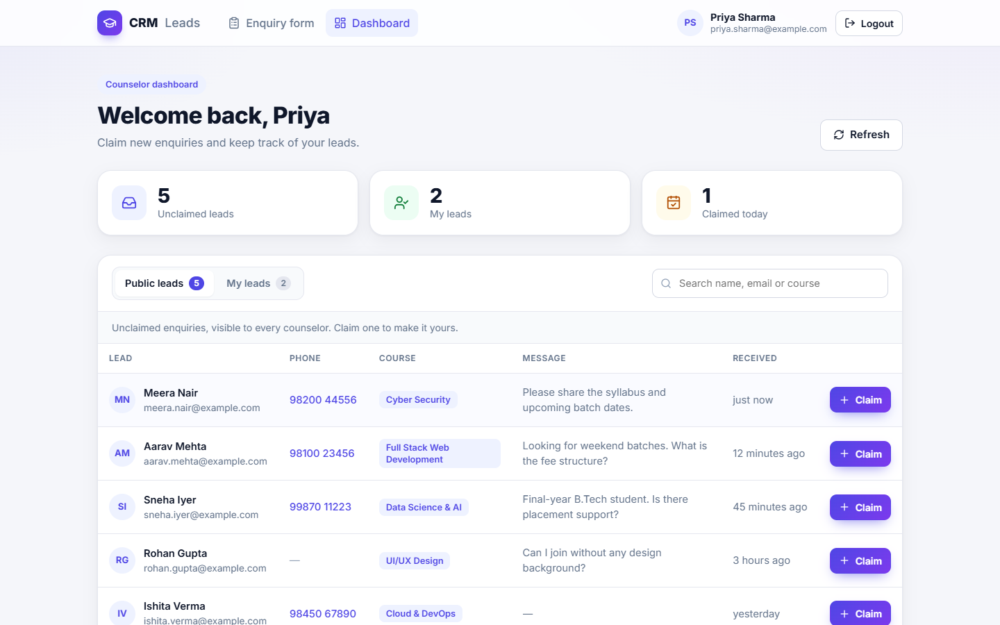
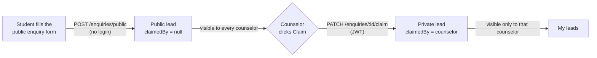
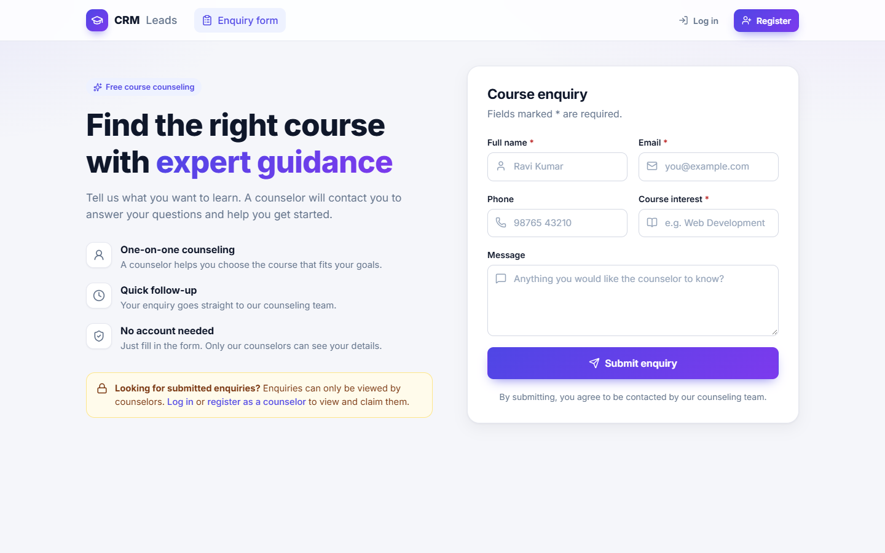
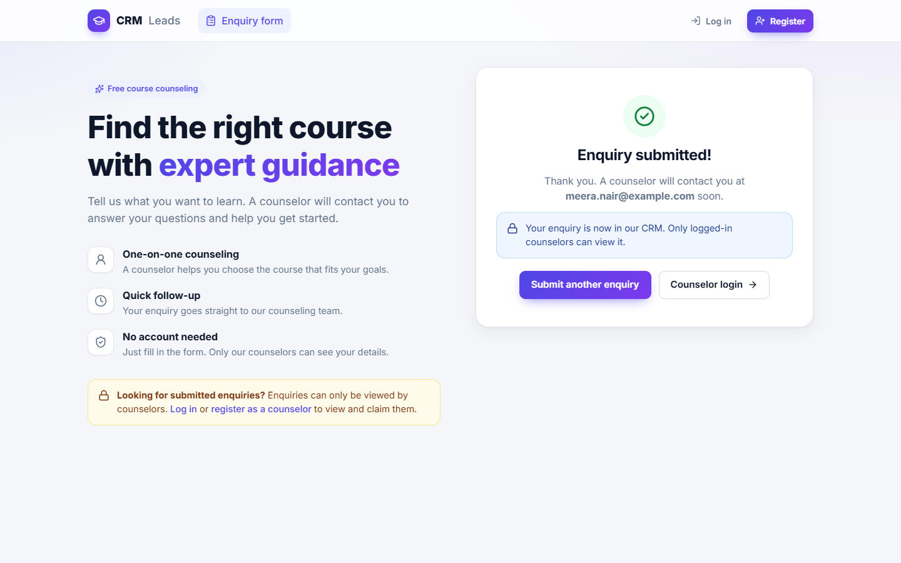
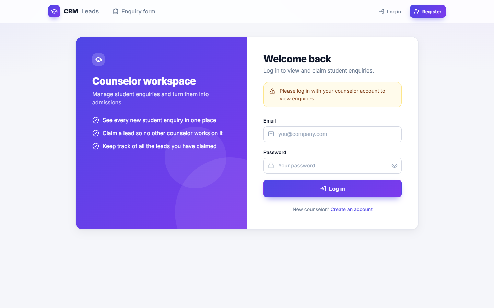
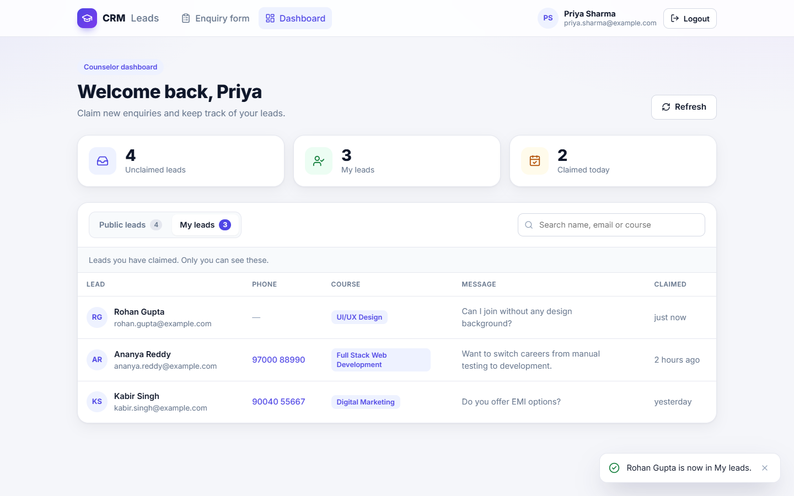
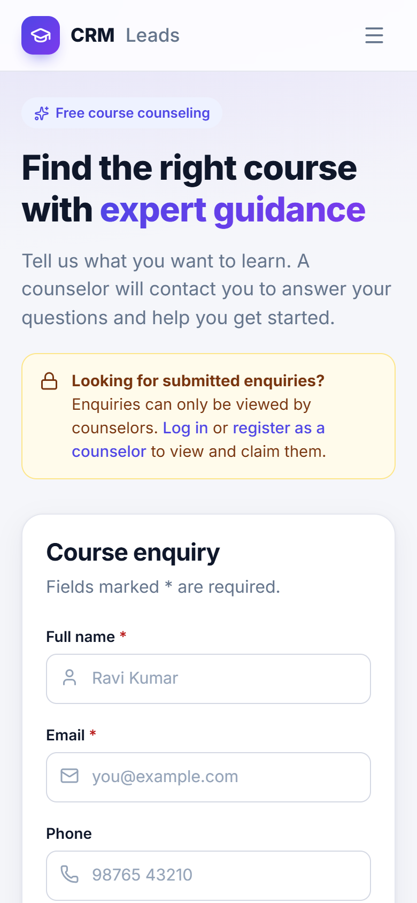
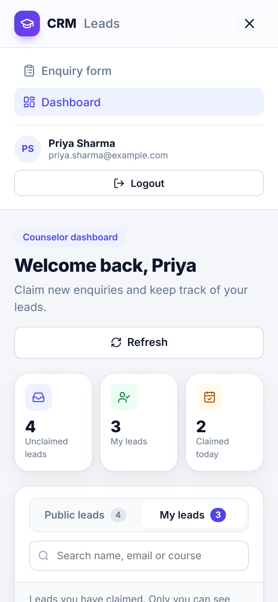
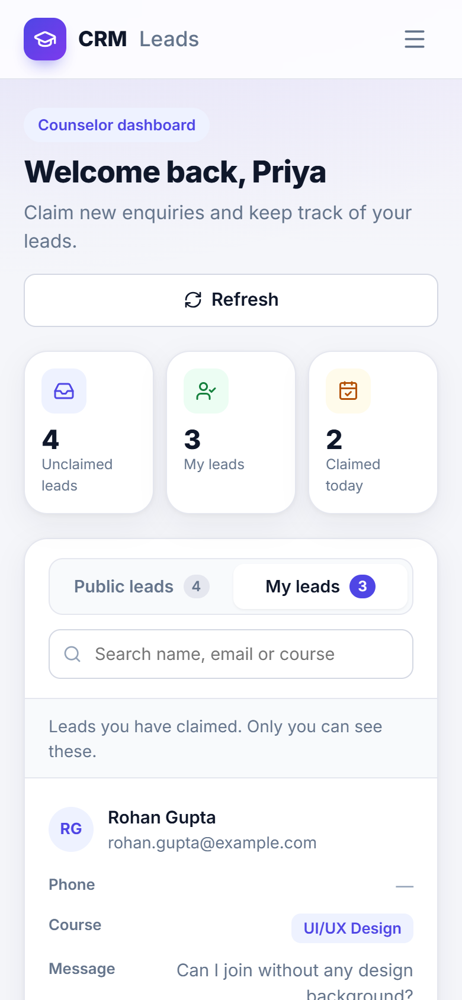

<div align="center">


<h1>CRM Lead Management</h1>

<p>
A REST API for a counseling CRM. Students submit enquiries without logging in.<br />
Counselors log in to see them and <b>claim</b> a lead so no one else works on it.
</p>

<p>


</p>

<p>
<a href="#-features">Features</a> ·
<a href="#-screenshots">Screenshots</a> ·
<a href="#-getting-started">Getting started</a> ·
<a href="#-api-reference">API reference</a> ·
<a href="#-design-decisions">Design decisions</a>
</p>

</div>

<br />



## ✨ Features

**REST API (the graded part)**

- **Employee register and login** with bcrypt-hashed passwords and JWT
- **Public enquiry form API** that needs no authentication
- **Unclaimed leads** that every counselor can see
- **Claim a lead** in one atomic database update, so two counselors can never claim the same lead
- **My leads**: only the counselor who claimed a lead can see it
- Consistent JSON errors with the right status codes (400, 401, 404, 409)

**React client (bonus)**

- Public enquiry page that tells visitors only counselors can view enquiries
- Counselor login and register, with a redirect back to the dashboard
- Dashboard with stats, Public / My leads tabs, search and one-click claim
- Responsive on all screen sizes: collapsible navbar, and lead rows become cards on small screens

## 🔄 How it works



| Actor | What they do | Login? |
|---|---|---|
| Prospective student | Fills the enquiry form (name, email, course interest) | No |
| Employee / counselor | Views public leads, claims leads, views their own leads | Yes, with a JWT |

Public and private enquiries are not separate collections. They are the same document, told apart by the `claimedBy` field.

## ✅ Acceptance criteria

| Requirement | Endpoint | Done |
|---|---|:---:|
| Employee register and login (JWT) | `POST /api/auth/register`, `POST /api/auth/login` | ✅ |
| Public form API without authentication | `POST /api/enquiries/public` | ✅ |
| Claim a lead | `PATCH /api/enquiries/:id/claim` | ✅ |
| Fetch unclaimed leads | `GET /api/enquiries/public` | ✅ |
| Fetch leads claimed by the logged-in user | `GET /api/enquiries/private` | ✅ |

## 📸 Screenshots

<table>
  <tr>
    <td width="50%">
      
      <p align="center"><b>Public enquiry form</b>: no login, with a note that only counselors can view enquiries</p>
    </td>
    <td width="50%">
      
      <p align="center"><b>After submitting</b>: confirmation and a link for counselors</p>
    </td>
  </tr>
  <tr>
    <td width="50%">
      
      <p align="center"><b>Counselor login</b>: shown when a logged-out visitor opens the dashboard</p>
    </td>
    <td width="50%">
      
      <p align="center"><b>My leads</b>: right after claiming a lead</p>
    </td>
  </tr>
</table>

<table>
  <tr>
    <td align="center" width="33%">
      
      <br /><b>Phone</b>: enquiry form
    </td>
    <td align="center" width="33%">
      
      <br /><b>Phone</b>: menu
    </td>
    <td align="center" width="33%">
      
      <br /><b>Phone</b>: leads as cards
    </td>
  </tr>
</table>

## 🧰 Tech stack

| Layer | Tools |
|---|---|
| API | Node.js, Express 5, `jsonwebtoken`, `bcryptjs`, `validator`, `cors`, `dotenv` |
| Database | MongoDB with Mongoose 9 |
| Client | React 19, Vite, React Router, Axios, lucide-react icons, plain CSS |
| Tooling | ESLint, nodemon, Postman collection |

## 🚀 Getting started

**Prerequisites:** Node.js 20+, and MongoDB running locally or a free [MongoDB Atlas](https://www.mongodb.com/atlas) cluster.

### 1. Run the API

```bash
git clone https://github.com/himanshu60/crm.git
cd crm/server
npm install
cp .env.example .env      # Windows: copy .env.example .env
npm run dev
```

The API starts on `http://localhost:5000`. Check it with `GET /api/health`.

Then fill in `server/.env`:

| Variable | What to put | Example |
|---|---|---|
| `PORT` | Port the API listens on | `5000` |
| `MONGO_URI` | Your MongoDB connection string | `mongodb://127.0.0.1:27017/crm` |
| `JWT_SECRET` | Any long random string | |
| `JWT_EXPIRES_IN` | How long a login stays valid | `1d` |

> [!TIP]
> Using MongoDB Atlas? Open **Connect → Drivers** in Atlas, copy the connection string, put your database user's password into it, and paste it as `MONGO_URI`.

> [!WARNING]
> `server/.env` holds your database password and JWT secret. It is git-ignored, so never commit real credentials.

The server refuses to start if `MONGO_URI` or `JWT_SECRET` is missing.

### 2. Run the React client (optional)

In a second terminal, from the folder you cloned into:

```bash
cd crm/client
npm install
npm run dev
```

Open `http://localhost:5173`. The client calls `http://localhost:5000/api` by default. To use another API URL, create `client/.env` with `VITE_API_URL=<url>` (see `client/.env.example`).

| Page | Route | Login? | What it does |
|---|---|---|---|
| Enquiry form | `/` | No | Students submit an enquiry. A notice explains that only counselors can view enquiries. |
| Register / Login | `/register`, `/login` | No | Counselor account. The JWT is saved in `localStorage`. |
| Dashboard | `/dashboard` | Yes | Stats, Public leads with a Claim button, My leads, and search |

## 📡 API reference

Base URL: `http://localhost:5000/api`

| Method | Route | Auth | Description |
|---|---|---|---|
| GET | `/health` | – | Health check |
| POST | `/auth/register` | – | Create an employee account |
| POST | `/auth/login` | – | Log in and get a JWT |
| POST | `/enquiries/public` | – | Submit the enquiry form |
| GET | `/enquiries/public` | JWT | List unclaimed leads |
| PATCH | `/enquiries/:id/claim` | JWT | Claim a lead |
| GET | `/enquiries/private` | JWT | List leads claimed by the logged-in employee |

Protected routes need the header `Authorization: Bearer <token>`.

<details>
<summary><b>Request and response examples</b></summary>

**Register**: `POST /api/auth/register`

```json
{ "name": "Asha Verma", "email": "asha@example.com", "password": "secret123" }
```

Response `201`. Login (`POST /api/auth/login` with `email` and `password`) returns the same shape with `200`.

```json
{
  "message": "Employee registered successfully",
  "token": "eyJhbGciOiJIUzI1NiIs...",
  "employee": { "id": "6ace3cd5377516b7fee32cf7", "name": "Asha Verma", "email": "asha@example.com" }
}
```

**Submit enquiry**: `POST /api/enquiries/public`. `name`, `email` and `courseInterest` are required.

```json
{ "name": "Ravi Kumar", "email": "ravi@example.com", "phone": "9876543210", "courseInterest": "Full Stack Web Development", "message": "Please share the fee details" }
```

Response `201`:

```json
{ "message": "Enquiry submitted successfully", "enquiry": { "_id": "6ace3cd5377516b7fee32cf8", "name": "Ravi Kumar", "...": "...", "claimedBy": null, "claimedAt": null } }
```

**Unclaimed leads** (`GET /api/enquiries/public`) and **my leads** (`GET /api/enquiries/private`): response `200`

```json
{ "count": 1, "enquiries": [ { "_id": "6ace3cd5377516b7fee32cf8", "name": "Ravi Kumar", "courseInterest": "Full Stack Web Development", "...": "..." } ] }
```

**Claim**: `PATCH /api/enquiries/:id/claim` with no body. Response `200`:

```json
{ "message": "Enquiry claimed successfully", "enquiry": { "_id": "6ace3cd5377516b7fee32cf8", "...": "...", "claimedBy": "6ace3cd5377516b7fee32cf7", "claimedAt": "2026-10-14T06:30:00.000Z" } }
```

If someone else claimed it first: `409` `{ "message": "Enquiry already claimed" }`

</details>

**Status codes.** Every error response has the shape `{ "message": "..." }`.

| Code | When |
|---|---|
| 400 | Missing or invalid fields, an invalid enquiry id, or malformed JSON |
| 401 | Missing, invalid or expired token, or wrong email/password |
| 404 | Enquiry or route not found |
| 409 | Email already registered, or enquiry already claimed |

## 🧠 Design decisions

- **Atomic claim.** A claim is one `findOneAndUpdate({ _id, claimedBy: null }, ...)`. If two counselors claim the same lead at the same moment, only one update matches. The other gets `409`, so a lead can never end up with two owners.
- **Public form accepts only the form fields.** `claimedBy` and `claimedAt` are never read from the request body, so nobody can claim a lead without logging in.
- **Passwords are hashed** with bcrypt. The field has `select: false` and is never returned in a response.
- **Login gives the same `401` message** for an unknown email and a wrong password, so valid emails can't be discovered. Type checks reject NoSQL operator injection such as `{ "email": { "$ne": null } }`.
- **The auth middleware** verifies the JWT and also checks that the employee still exists.
- **A central error handler** turns Mongoose validation, cast and duplicate-key errors into clean `400` and `409` responses. Express 5 forwards async errors to it, so controllers need no try/catch.
- **An index on `{ claimedBy, createdAt }`** serves both lead lists, which filter on `claimedBy` and sort by date.

## 🧩 Data model

| Collection | Fields |
|---|---|
| **Employee** | `name`, `email` (unique, lowercase), `password` (bcrypt hash), timestamps |
| **Enquiry** | `name`, `email`, `phone` (optional), `courseInterest`, `message` (optional), `claimedBy` (Employee id, `null` while public), `claimedAt`, timestamps |

## 📁 Project structure

<details>
<summary><b>Show the folder tree</b></summary>

```
crm/
├── server/
│   ├── src/
│   │   ├── config/db.js              # MongoDB connection
│   │   ├── models/                   # Employee, Enquiry
│   │   ├── middleware/
│   │   │   ├── auth.js               # verify Bearer token, set req.user
│   │   │   └── errorHandler.js       # 404 + central error -> JSON
│   │   ├── controllers/
│   │   │   ├── auth.controller.js    # register, login
│   │   │   └── enquiry.controller.js # create, list public, claim, list mine
│   │   ├── routes/                   # /api/auth, /api/enquiries
│   │   └── app.js                    # express app, middleware, routes
│   ├── server.js                     # load env, connect DB, start server
│   └── .env.example
├── client/
│   └── src/
│       ├── api/axios.js              # base URL + attaches the JWT
│       ├── context/                  # AuthContext + AuthProvider
│       ├── components/               # Navbar, ProtectedRoute, LeadsTable, Toast, ...
│       ├── pages/                    # EnquiryForm, Login, Register, Dashboard
│       ├── utils/format.js           # relative time, initials
│       └── index.css                 # design tokens + responsive styles
├── docs/screenshots/
├── CRM-API.postman_collection.json
└── README.md
```

</details>

## 🧪 Testing with Postman

1. Import `CRM-API.postman_collection.json` into Postman.
2. Start the API (`npm run dev` in `server/`).
3. Run the requests from top to bottom. **Register** or **Login** saves the token automatically, and **Submit Enquiry** saves `enquiryId` for **Claim Lead**.

If the API runs somewhere else, change the `baseUrl` collection variable (default `http://localhost:5000/api`).

## 📜 Scripts

| Folder | Command | What it does |
|---|---|---|
| `server/` | `npm run dev` | Start with nodemon (restarts on file changes) |
| `server/` | `npm start` | Start with node |
| `server/` | `npm run lint` | Run ESLint |
| `client/` | `npm run dev` | Start the Vite dev server |
| `client/` | `npm run build` | Production build into `client/dist` |
| `client/` | `npm run lint` | Run ESLint |
